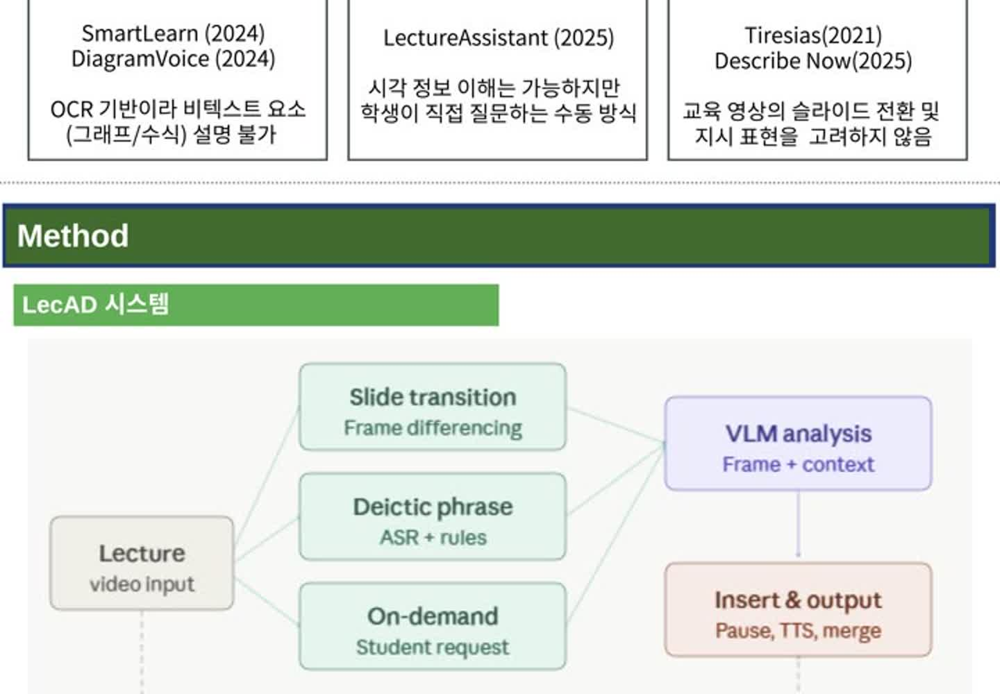
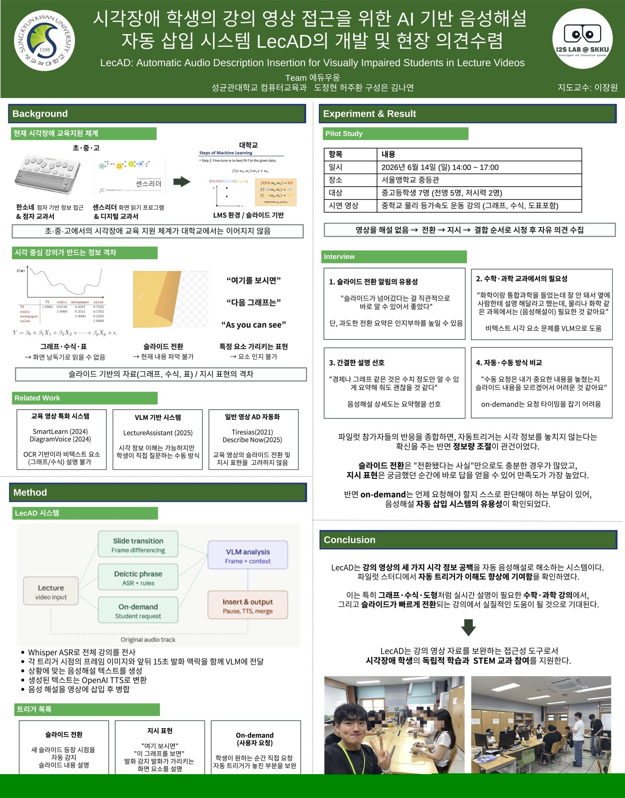

# LecAD

### 시각장애 학생의 강의 영상 접근을 위한 AI 기반 음성해설 자동 삽입 시스템

[도정현](https://github.com/MrDoLab) · [허주환](https://github.com/juhwan0628) · [구성은](https://github.com/sseuniiill-dot) · [김나연](https://github.com/GiveMeKite)

성균관대학교 컴퓨터교육과 · 지도교수 이장원

[2026-1 SKKU Co-Deep Learning Award](https://www.spressnews.com/news/articleView.html?idxno=138550)

  

## Abstract

온라인 강의에서 “여기를 보시면”, “다음 그래프는”과 같은 지시 표현은 화면의 시각 정보를 전제로 합니다. 시각장애 학생은 강의 중 등장하는 그래프, 수식, 도표를 화면 읽기 프로그램만으로 파악하기 어렵습니다.

LecAD는 영상 내 슬라이드 전환과 교수자의 지시 표현을 감지하고, 화면 및 발화 맥락을 바탕으로 음성해설을 생성해 강의 영상에 삽입하는 시스템입니다. 강의 내용을 모두 낭독하기보다 시각 정보가 필요한 순간에 짧은 설명을 제공하는 데 초점을 맞췄습니다.

## Method

| 해설 시점 | 방식 |
| --- | --- |
| 슬라이드 전환 | 슬라이드가 바뀌는 시점을 감지해 화면 전환을 알림 |
| 지시 표현 | “이 그래프”, “여기를 보시면” 등의 발화가 가리키는 화면 요소를 설명 |
| On-demand | 학습자가 원하는 순간 직접 해설을 요청 |

Whisper 기반 전사에서 발화의 시점과 맥락을 수집하고, 해당 프레임을 VLM에 전달해 설명을 생성합니다. 생성된 문장은 TTS로 음성화하고 원본 강의 영상에 삽입합니다.

## Pilot Study

2026년 6월 14일 서울맹학교에서 중·고등학생 7명(전맹 5명, 저시력 2명)과 파일럿 스터디를 진행했습니다. 그래프와 수식이 포함된 과학 강의 영상을 활용해 해설이 없는 영상, 슬라이드 전환, 지시 표현, 결합 방식에 대한 의견을 수집했습니다.

학생들은 슬라이드가 바뀌었다는 알림 자체를 유용하게 평가했고, 수학·과학의 시각 자료에는 간결한 설명을 선호했습니다. 특히 지시 표현에 맞춰 화면 요소를 설명하는 방식에 대한 반응이 가장 긍정적이었습니다. 반면 On-demand 방식에서는 해설을 요청할 시점을 판단하기 어렵다는 의견이 있었습니다.

## Poster

  

## Implementation

이 저장소에는 지시 표현 탐지, VLM 분석, TTS 합성, FFmpeg 렌더링으로 이어지는 Python 기반 오프라인 처리 파이프라인을 담았습니다. 원본 강의의 발화가 끝난 뒤 해설을 삽입하고, 해설이 재생되는 동안 해당 프레임을 유지합니다.

[소스코드](./lecad/) · [테스트](./tests/) · [시스템 설계](./docs/ARCHITECTURE.md) · [설치 및 실행](./docs/PIPELINE_GUIDE.md)

---

성균관대학교 Co-Deep Learning 프로젝트 · 2026.03–07
